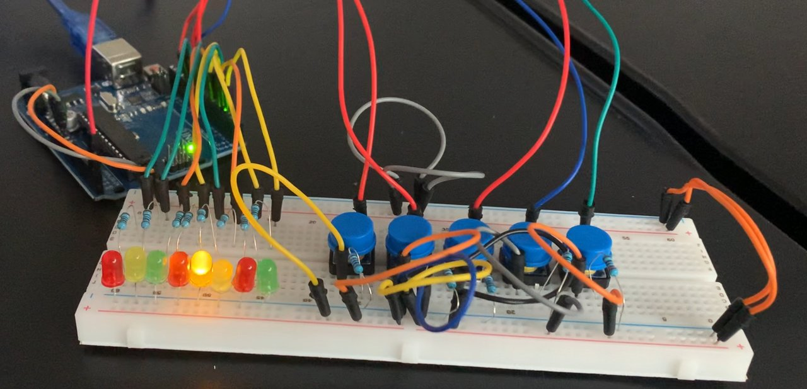

# Experiment 1: Symphony of Lights

**Course:** CPE160P – Embedded Systems and Design

## Overview

A light show that plays hard-coded LED patterns in time with five songs. Each push button starts a different song's routine on a row of 8 LEDs. I first tried driving the LEDs from a sound sensor, but the lights blinked randomly instead of following the beat, so the patterns were hand-timed to each song's rhythm instead.

Songs: *Paranoid* (Post Malone), *Sweet Child O' Mine* (Guns N' Roses), *Cold Water* (Justin Bieber), *Wonderwall* (Oasis), *Bangarang* (Skrillex).

## Hardware

- Arduino Uno
- 8 LEDs (pins 2–9)
- 5 push buttons (pins 10–13, A5)

## How it works

- `loop()` polls the five buttons; each one calls `playSong(n)` for its song.
- Each song is a sequence of reusable pattern functions (`patternAlternate*`, `randomLed`, `allOn`) and song-specific beats (`paranoidBeat`, `sweetBeat`, `coldBeat`, `wonderwallBeat`) timed with `delay()`.

## Files

| File | Description |
|---|---|
| [`01-symphony-of-lights.ino`](01-symphony-of-lights.ino) | Arduino sketch |

## Demo

- [Raw video – part 1](https://youtu.be/sZk4krv5_Zw)
- [Raw video – part 2](https://youtu.be/FM5j47fO4SA)
