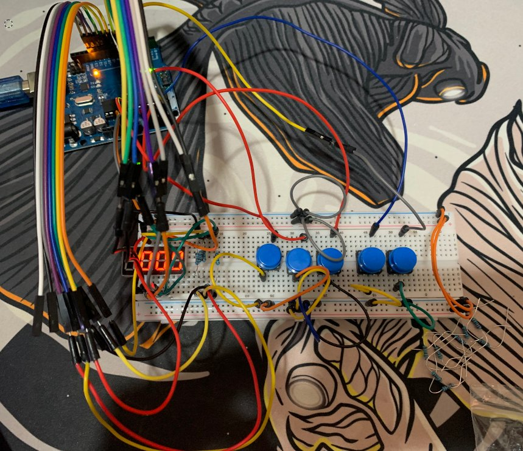

# Experiment 2: Number System Emulator

**Course:** CPE160P – Embedded Systems and Design

## Overview

A number system converter that shows its input and result on a 4-digit seven-segment display. It has three modes: binary to decimal, octal to decimal, and decimal to binary. Three buttons each step one digit through the current base, and a fourth button shows the converted value. The hardest part was wiring the display: most tutorials used a different model with a different pinout, so I had to work out the connections myself through testing.

## Hardware

- Arduino Uno
- 4-digit seven-segment display, common cathode (digits on pins 10–13, segments on pins 2–9)
- 5 push buttons (A0–A4), using the internal pull-ups

## Libraries

- `SevSeg` – drives and multiplexes the 4-digit seven-segment display

## How it works

- `getInput(base)` reads the three digit buttons (A0–A2); each press cycles that digit from 0 up to base − 1.
- The mode button (A4) cycles through the three modes, briefly shows `BD`, `OD` or `DB`, and clears the digits.
- The convert button (A3) runs `binaryToDecimal()`, `octalToDecimal()` or `decimalToBinary()` and shows the result (binary output is limited to four digits).
- `buttonPressedEdge()` debounces each button and keeps calling `sevseg.refreshDisplay()` while a button is held, so the display doesn't go dark.

## Files

| File | Description |
|---|---|
| [`02-number-system-emulator.ino`](02-number-system-emulator.ino) | Arduino sketch |

## Demo

- [Raw video](https://youtu.be/K1Vss_ZT-jQ)
