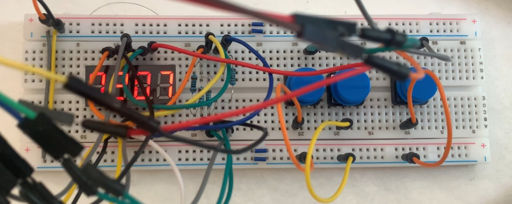

# Experiment 3: Clock

**Course:** CPE160P – Embedded Systems and Design

## Overview

A 24-hour digital clock that shows hours and minutes on a 4-digit seven-segment display. Two buttons set the hour and minute, and a third confirms the time. My first version of `clock()` used a long `delay()` before refreshing, which blocked the display so button presses didn't show up; replacing it with a wait loop that keeps refreshing the display fixed it.

## Hardware

- Arduino Uno
- 4-digit seven-segment display, common cathode (digits on pins 2–5, segments on pins 6–13)
- 3 push buttons (A0–A2), using the internal pull-ups

## Libraries

- `SevSeg` – drives and multiplexes the 4-digit seven-segment display

## How it works

- `getInput()` watches for button presses: A0 adds an hour (wraps at 24), A1 adds a minute (wraps at 60), and A2 confirms the time and calls `clock()`.
- `clock()` rolls 60 minutes over into the next hour (and 24 hours back to 0), shows the time, advances one minute and waits about a minute.
- `waitAndRefresh()` waits in 1 ms steps while calling `sevseg.refreshDisplay()`, so the display stays lit during long waits.
- `displayTime()` formats the time as four digits (`HHMM`) for the display.

## Files

| File | Description |
|---|---|
| [`03-clock.ino`](03-clock.ino) | Arduino sketch |

## Demo

- [Raw video – part 1](https://youtu.be/i5TJKlgW69Q)
- [Raw video – part 2](https://youtu.be/6A_wQZwKrtQ)
