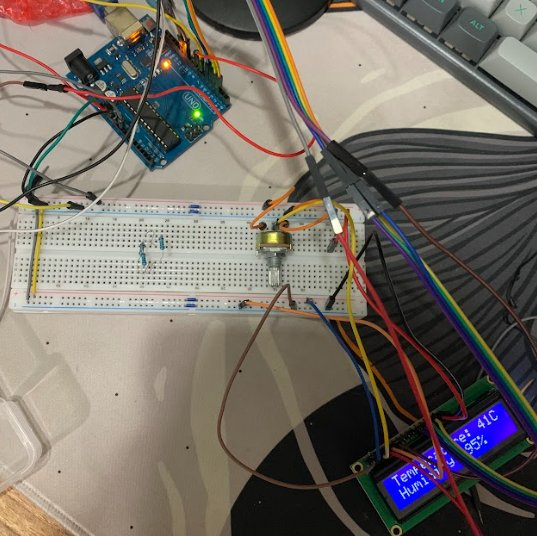
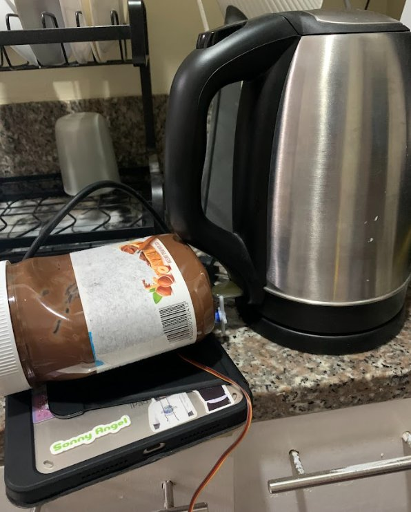

# Experiment 4: Kettle

**Course:** CPE160P – Embedded Systems and Design

  
  

## Overview

A kettle system that watches for boiling and switches the kettle off automatically. A DHT11 sensor reads temperature and humidity, the values are shown on a 16x2 LCD, and once the readings reach the boiling condition a servo presses the kettle's switch. I first thought my DHT11 was broken and even bought a DHT22 to replace it, but the real problem was that I had wired it from a tutorial for a similar-looking sensor with a different pinout.

## Hardware

- Arduino Uno
- DHT11 temperature and humidity sensor (pin 7)
- 16x2 LCD, wired directly without an I2C module (RS 12, E 11, D4–D7 on pins 5, 4, 3, 2)
- SG90 servo motor (pin 8)

## Libraries

- `Servo` – moves the servo that presses the kettle's switch
- `DHT11` – reads temperature and humidity from the DHT11
- `LiquidCrystal` – drives the 16x2 LCD in 4-bit mode

## How it works

- Every 2 seconds, `loop()` reads the sensor with `readTemperatureHumidity()` and prints temperature and humidity to the LCD and Serial Monitor.
- When temperature is at least 80 °C and humidity at least 90 %, it calls `servoActivate()`.
- `servoActivate()` sweeps the servo from 10° to 180° and back to press the kettle's switch off.

## Files

| File | Description |
|---|---|
| [`04-kettle.ino`](04-kettle.ino) | Arduino sketch |

## Demo

- [Raw video – part 1](https://youtu.be/tbTDKhuZFGo)
- [Raw video – part 2](https://youtu.be/JqqT8cFgW-0)
