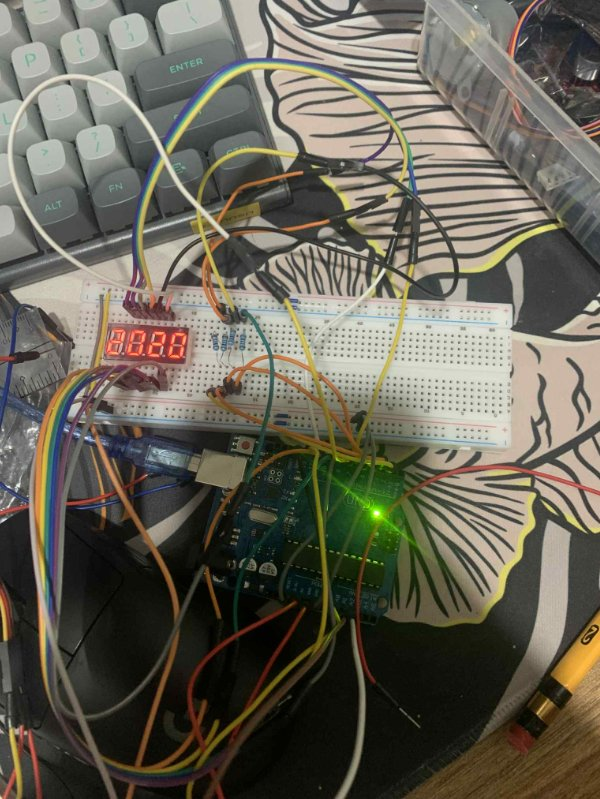
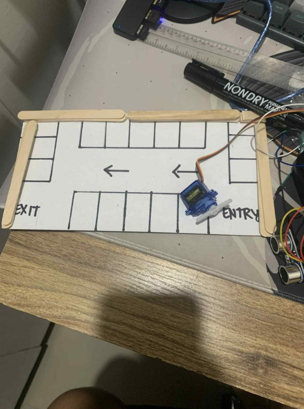

# Experiment 5: Parking Lot Counter

**Course:** CPE160P – Embedded Systems and Design

  
  

## Overview

A miniature parking lot that counts free slots and opens a gate for cars. An ultrasonic sensor detects cars at the gate, a servo opens it, and a 4-digit seven-segment display shows how many of the 20 slots are free; when the lot is full, the gate stays closed for entering cars. At first the sensor kept decrementing the counter for as long as a car stayed in front of it, so I added a flag that counts each car only once until it leaves.

## Hardware

- Arduino Uno
- Ultrasonic distance sensor (trigger on pin 15 / A1, echo on pin 16 / A2)
- Servo motor as the gate (pin 14 / A0)
- 4-digit seven-segment display, common cathode (digits on pins 2–5, segments on pins 6–13)

## Libraries

- `NewPing` – reads the ultrasonic sensor's distance in cm
- `Servo` – drives the gate servo
- `SevSeg` – drives and multiplexes the 4-digit seven-segment display

## How it works

- `distanceSensor()` reads the distance with `sonar.ping_cm()`: under 10 cm counts as a car entering, 15–40 cm as a car exiting.
- `loop()` takes a slot when a car enters and frees one when a car exits (kept between 0 and 20); the `gateDone` flag makes each car count only once until it leaves.
- `gateEnter()` swings the servo to 90° to open the gate while a car is detected; entering cars only get through if a slot is free.
- `displayNum()` shows the free-slot count (the two digits appear on both halves of the display), and `waitAndRefresh()` keeps the display lit while the gate is open.

## Files

| File | Description |
|---|---|
| [`05-parking-lot-counter.ino`](05-parking-lot-counter.ino) | Arduino sketch |

## Demo

- [Raw video](https://youtu.be/oA8puzgeNeA)
