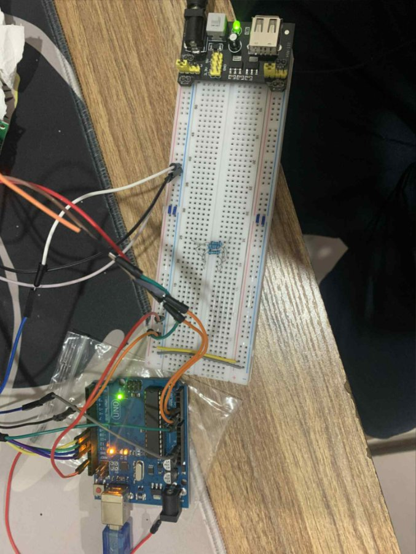
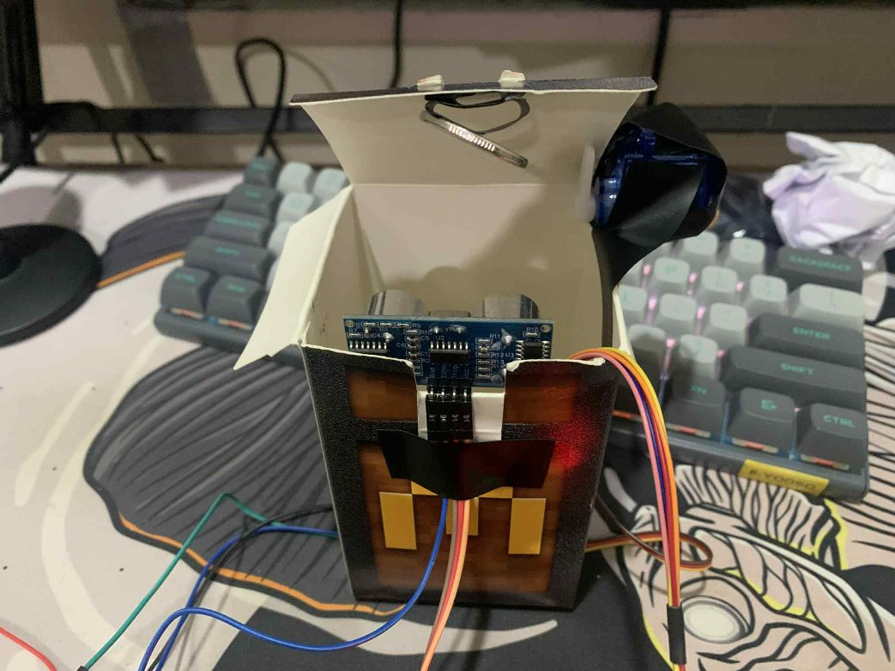

# Experiment 6: Automatic Trash Can

**Course:** CPE160P – Embedded Systems and Design

  
  

## Overview

A trash can that closes its lid and compacts its contents once it's full. An ultrasonic sensor checks the fill level, and when the can is full a servo closes the lid and a stepper motor spins a crusher. The code was simple; the hard part was the mechanics, so I improvised the crusher from chopsticks taped to the stepper motor, spinning like a blender to compress the trash.

## Hardware

- Arduino Uno
- Ultrasonic distance sensor (trigger on pin 15 / A1, echo on pin 16 / A2)
- Servo motor for the lid (pin 14 / A0)
- Stepper motor for the crusher (pins 8, 10, 9, 11)

## Libraries

- `NewPing` – reads the ultrasonic sensor's distance in cm
- `Stepper` – spins the crusher (2048 steps per revolution, 10 RPM)
- `Servo` – opens and closes the lid

## How it works

- `loop()` reads the distance with `sonar.ping_cm()` every 100 ms.
- Under 5 cm means the can is full: the servo moves to 0° to close the lid and `stepper.step(128)` turns the crusher.
- Otherwise the servo stays at 90° and the lid stays open.

## Files

| File | Description |
|---|---|
| [`06-automatic-trash-can.ino`](06-automatic-trash-can.ino) | Arduino sketch |

## Demo

- [Raw video](https://youtu.be/uZIbNOh4xQQ)
