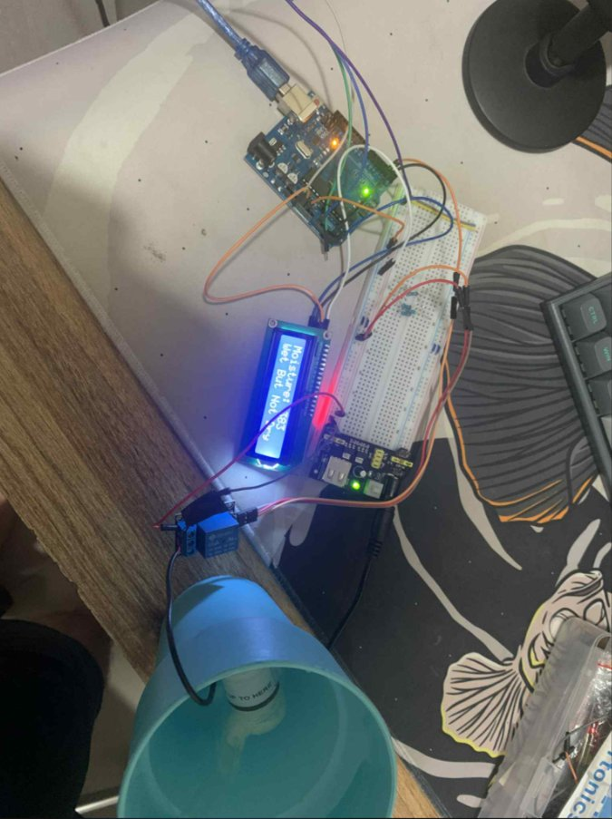
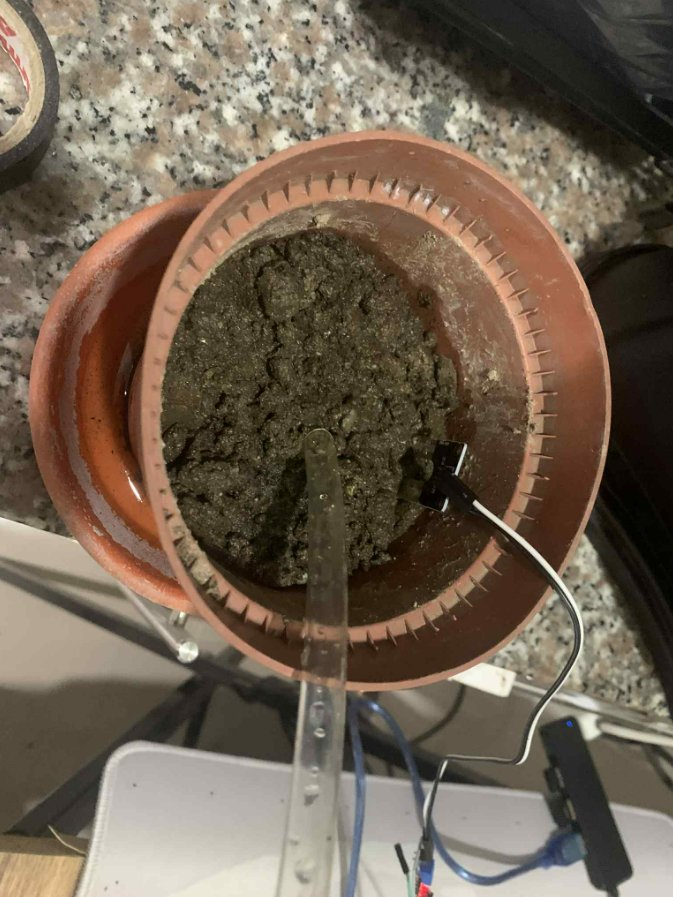

# Experiment 7: Watering Plant System

**Course:** CPE160P – Embedded Systems and Design

  
  

## Overview

An automatic plant waterer. A soil moisture sensor reads the soil, a 16x2 I2C LCD shows the reading and a dryness label, and when the soil is too dry a relay turns on a small 5 V pump for two seconds. The pump only has power leads, so I couldn't drive it from a pin like a servo; I learned to use a relay as a switch between the pump and its own power supply.

## Hardware

- Arduino Uno
- Soil moisture sensor (A0)
- Relay module (signal on pin 2)
- 5 V water pump, switched by the relay on a separate supply
- 16x2 LCD with I2C module (address 0x27)

## Libraries

- `LCD-I2C` – drives the 16x2 LCD over I2C
- `Wire` – I2C bus used by the LCD

## How it works

- `loop()` reads the sensor with `analogRead(A0)` and shows the value plus a label (Super Dry, Normal, Wet But Not Dry, Wet, Super Wet) on the LCD.
- When the reading is 390 or higher (Normal or drier), it switches the relay on for 2 seconds to run the pump, then waits a 1-minute cooldown before checking again.

## Files

| File | Description |
|---|---|
| [`07-watering-plant-system.ino`](07-watering-plant-system.ino) | Arduino sketch |

## Demo

- [Raw video](https://youtu.be/_iETZUPvkDQ)
