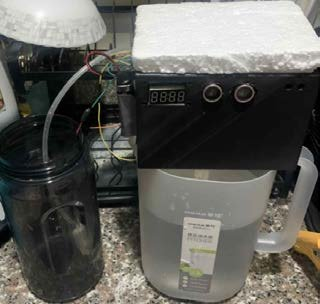

# Final Project: Smart Toilet Flush System

**Course:** CPE160P – Embedded Systems and Design

## Overview

A hands-free flush controller for shared restrooms. An ultrasonic sensor detects when someone is at the toilet, double-checks that they've left, and then a servo opens the flapper to flush and a pump refills it. A TM1637 display counts flushes, and the prototype is a small 3D-printed setup. PLA isn't ideal for parts that hold water, so the next step would be a sealed housing or plumbing parts rated for continuous water contact.

## Hardware

- Arduino Uno
- HC-SR04 ultrasonic sensor (trigger pin 9, echo pin 8)
- Servo motor on the flapper (pin 6)
- 1-channel relay and a 5 V pump for refilling (pin 7)
- TM1637 4-digit seven-segment display (CLK pin 4, DIO pin 5)
- Red LED with resistor, the flushing indicator (pin 13)
- MB102 power supply module and an external 9 V battery pack

## Libraries

- `NewPing` – median ultrasonic echo readings
- `Servo` – drives the flapper servo
- `TM1637Display` – shows the flush count and `FLSH`

## How it works

- `readEcho()` takes a median of 5 pings with `sonar.ping_median()`; at or below 1000 µs (~17 cm) the stall is marked occupied.
- When the reading rises above the threshold, `loop()` waits 2 s and samples again; only a second clear reading confirms the user has left.
- On confirmation, `flush()` opens the flapper with the servo for 10 s while the LED lights and the display shows `FLSH`, then closes it.
- The relay then runs the pump for 40 s to refill, the flush count goes up on the display, and the system goes back to sensing.

## Results

Across 10 trials, every flush was successful, with no missed or false flushes. Measured stage times averaged 2.05 s for confirmation, 10.48 s for the flush and 40.10 s for the refill, matching the designed timings.

## Files

| File | Description |
|---|---|
| [`project-smart-toilet-flush-system.ino`](project-smart-toilet-flush-system.ino) | Arduino sketch (reconstructed) |

> **Note:** The final sketch was lost. This one is rebuilt from the Progress Report 1 code, transcribed from its screenshots, and updated to the final behavior and timings in the project documentation. The pins come from that code, except the TM1637 pins (4, 5), which are assumed. It hasn't been tested on the original hardware.
