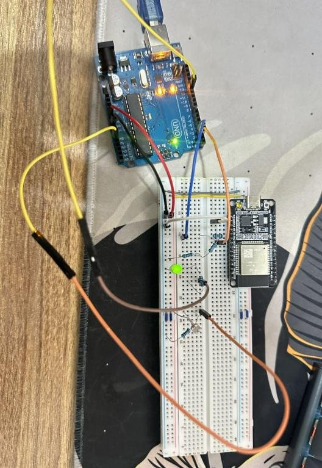

# Experiment 1: IoT based Automated Street Lighting System

**Course:** CPE162P – Embedded Systems with IoT

## Overview

A street light that switches itself on when it gets dark and logs the light level and lamp state to ThingSpeak. An Arduino Uno reads a photoresistor and drives the LED, then passes both values to an ESP32, which uploads them over WiFi. Connecting the Uno's 5V TX pin straight to the ESP32's 3.3V RX pin can damage the ESP32, so that line needs a logic level converter or a voltage divider.

## Hardware

**Arduino Uno**
- Photoresistor (A0)
- LED (pin 12)

**ESP32**
- WiFi link to ThingSpeak

## Libraries

- `SoftwareSerial.h` (Uno): serial link to the ESP32
- `WiFi.h` (ESP32): connects to the WiFi network
- `ThingSpeak.h` (ESP32): writes fields to the ThingSpeak channel

## How it works

- The Uno reads the photoresistor on A0. Below a threshold of 10 it turns the LED on (`led_status = 1`); otherwise it turns it off.
- Every 15 s (a `millis()` timer, no `delay()`) it sends `light,led_status` as one line over SoftwareSerial (Uno RX/TX = pins 2/3) to the ESP32's `Serial2` (RX/TX = GPIO 16/17) at 9600 baud.
- The ESP32 splits the line at the comma with `indexOf()` and `substring()` and converts both parts to integers.
- It uploads each line it receives, so once every 15 s: Field 1 = LED status, Field 2 = light level, Field 3 = WiFi signal strength (RSSI).

## Setup

The WiFi credentials and ThingSpeak write API key in `esp32/esp32.ino` were replaced with placeholders. Fill in `YOUR_WIFI_SSID`, `YOUR_WIFI_PASSWORD` and `YOUR_THINGSPEAK_WRITE_API_KEY`, and set `CHANNEL_ID` to your own ThingSpeak channel before uploading. The ESP32 only connects to 2.4GHz networks.

## Files

| File | Description |
|---|---|
| [`arduino/arduino.ino`](arduino/arduino.ino) | Arduino Uno sketch: light sensing, LED control, serial output |
| [`esp32/esp32.ino`](esp32/esp32.ino) | ESP32 sketch: parses the serial data and uploads it to ThingSpeak |

## Demo

- [Raw video](https://youtu.be/1sVWMs7thdQ)
