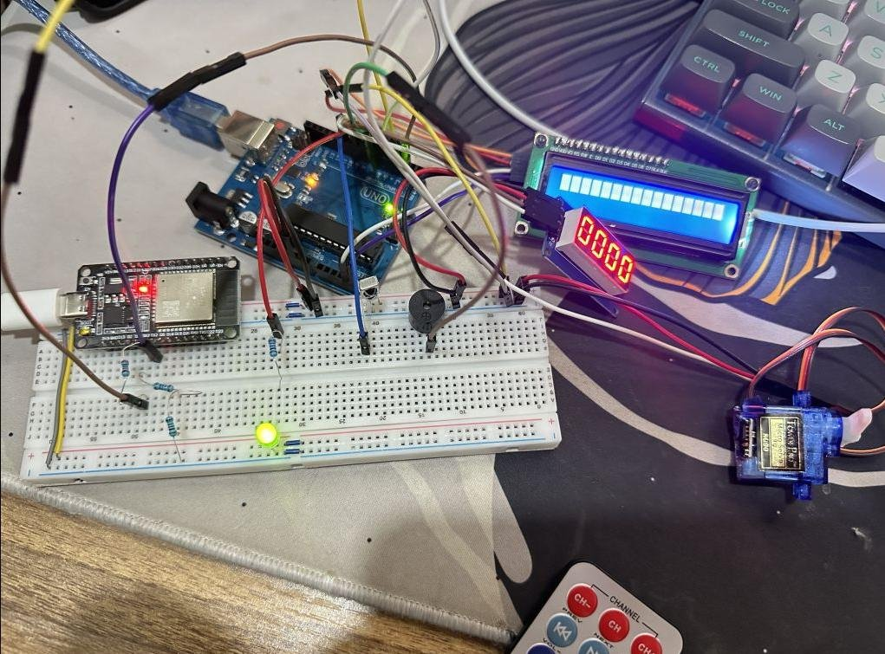

# Experiment 2: Home Appliance Automation using IoT

**Course:** CPE162P – Embedded Systems with IoT

## Overview

Five "appliances" (an LED, a buzzer, an LCD, a seven-segment display and a servo motor) switched on and off with an IR remote, with each one's on/off status logged to ThingSpeak. I reused my local version of this system from CPE161P (Real-Time Embedded Systems) and turned it into an IoT device by adding an ESP32 to push the statuses to the cloud. The trickiest part was on the ESP32 side: locating all four commas in each incoming line to split out the five values.

## Hardware

**Arduino Uno**
- IR receiver (pin 11) and IR remote
- LED (pin 6)
- Buzzer (pin 7)
- Servo motor (pin 5)
- TM1637 seven-segment display (CLK pin 9, DIO pin 8)
- 16×2 I2C LCD (address 0x27)

**ESP32**
- WiFi link to ThingSpeak

## Libraries

- `SoftwareSerial.h` (Uno): serial link to the ESP32
- `IRremote.hpp` (Uno): decodes the IR remote buttons
- `Servo.h` (Uno): drives the servo
- `LiquidCrystal_I2C.h` (Uno): controls the I2C LCD
- `TM1637Display.h` (Uno): drives the seven-segment display
- `WiFi.h` (ESP32): connects to the WiFi network
- `ThingSpeak.h` (ESP32): writes fields to the ThingSpeak channel

## How it works

- Remote buttons 1–5 toggle the LCD backlight, buzzer, LED, servo and seven-segment display (matched by raw IR code, e.g. `0xF30CFF00` for button 1). While the display is on, `+` and `-` change the number it shows.
- Each appliance has a 1/0 status; when switched on, the servo turns to 120° (back to 0° when off).
- Every 15 s (a `millis()` timer) the Uno sends `led,buzzer,lcd,ssd,motor` as one line over SoftwareSerial (Uno RX/TX = pins 2/3) to the ESP32's `Serial2` (RX/TX = GPIO 16/17) at 9600 baud.
- The ESP32 finds the four commas with `indexOf()`, splits the values with `substring()`, and uploads each line it receives (once every 15 s): Fields 1–5 = LED, buzzer, LCD, seven-segment display, servo.

## Setup

The WiFi credentials and ThingSpeak write API key in `esp32/esp32.ino` were replaced with placeholders. Fill in `YOUR_WIFI_SSID`, `YOUR_WIFI_PASSWORD` and `YOUR_THINGSPEAK_WRITE_API_KEY`, and set `CHANNEL_ID` to your own ThingSpeak channel before uploading.

## Files

| File | Description |
|---|---|
| [`arduino/arduino.ino`](arduino/arduino.ino) | Arduino Uno sketch: IR remote control of the five appliances, serial output |
| [`esp32/esp32.ino`](esp32/esp32.ino) | ESP32 sketch: parses the five statuses and uploads them to ThingSpeak |

## Demo

- [Raw video](https://youtu.be/X9opx_9eJgc)
