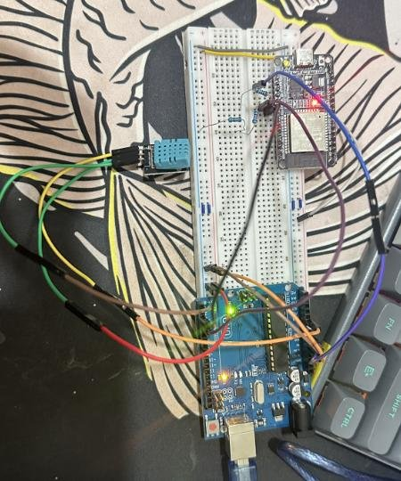

# Experiment 3: IoT based Weather Monitoring System

**Course:** CPE162P – Embedded Systems with IoT

## Overview

A weather station that measures temperature and humidity with a DHT11 and logs them to ThingSpeak. The Arduino Uno reads the sensor and passes the values to an ESP32, which uploads them over WiFi. To check that the sensor responded, I tested it in five places: inside the house, inside a bag, in the comfort room (humidity went up), on the roof (highest temperature, from direct sun) and in my hand (body heat made the temperature spike).

## Hardware

**Arduino Uno**
- DHT11 temperature and humidity sensor (A0)

**ESP32**
- WiFi link to ThingSpeak

## Libraries

- `DHT11.h` (Uno): reads temperature and humidity from the DHT11
- `SoftwareSerial.h` (Uno): serial link to the ESP32
- `WiFi.h` (ESP32): connects to the WiFi network
- `ThingSpeak.h` (ESP32): writes fields to the ThingSpeak channel

## How it works

- The Uno reads temperature and humidity from the DHT11.
- Every 20 s (a `millis()` timer) it sends `temp,hum` as one line over SoftwareSerial (Uno RX/TX = pins 2/3) to the ESP32's `Serial2` (RX/TX = GPIO 16/17) at 9600 baud.
- The ESP32 splits the line at the comma with `indexOf()` and `substring()` and converts both parts to integers.
- It uploads each line it receives (once every 20 s): Field 1 = temperature, Field 2 = humidity.

## Setup

The WiFi credentials and ThingSpeak write API key in `esp32/esp32.ino` were replaced with placeholders. Fill in `YOUR_WIFI_SSID`, `YOUR_WIFI_PASSWORD` and `YOUR_THINGSPEAK_WRITE_API_KEY`, and set `CHANNEL_ID` to your own ThingSpeak channel before uploading.

## Files

| File | Description |
|---|---|
| [`arduino/arduino.ino`](arduino/arduino.ino) | Arduino Uno sketch: DHT11 readings, serial output |
| [`esp32/esp32.ino`](esp32/esp32.ino) | ESP32 sketch: parses temperature and humidity and uploads them to ThingSpeak |
