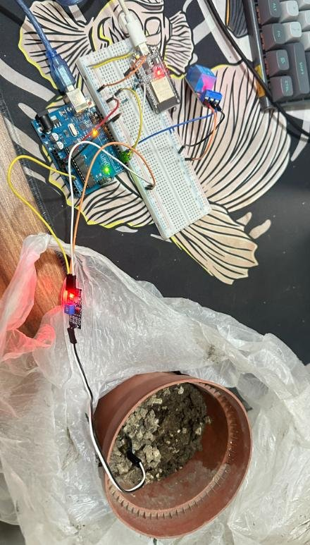

# Experiment 4: IoT based Irrigation System

**Course:** CPE162P – Embedded Systems with IoT

## Overview

An automatic irrigation system that waters the soil when it gets too dry and logs soil moisture and pump activity to ThingSpeak. The Arduino Uno reads a soil moisture sensor, sorts each reading into one of five states from "Super Wet" to "Super Dry", and runs a water pump through a relay for two seconds when the soil is dry. To stay within ThingSpeak's update limit, the ESP32 keeps the latest values and uploads them on its own 16-second timer rather than on every reading.

## Hardware

**Arduino Uno**
- Soil moisture sensor (A1)
- Relay and water pump (pin 4)

**ESP32**
- WiFi link to ThingSpeak

## Libraries

- `SoftwareSerial.h` (Uno): serial link to the ESP32
- `WiFi.h` (ESP32): connects to the WiFi network
- `ThingSpeak.h` (ESP32): writes fields to the ThingSpeak channel

## How it works

- Every 500 ms the Uno reads the sensor on A1 and prints its state to the Serial Monitor: ≤450 Super Wet, ≤550 Wet, ≤650 Wet But Not Dry, ≤800 Normal, above 800 Super Dry.
- When the reading reaches 1000 or more, pin 4 switches the pump on for 2 s (timed with `millis()`, no `delay()`).
- On the same 500 ms tick it sends `sensorValue,pump_state` as one line over SoftwareSerial (Uno RX/TX = pins 2/3) to the ESP32's `Serial2` (RX/TX = GPIO 16/17) at 9600 baud.
- The ESP32 splits each line at the comma and stores the latest values. Every 16 s it uploads them (reconnecting to WiFi first if needed): Field 1 = soil moisture reading, Field 2 = pump state (1 = on).

## Setup

The WiFi credentials and ThingSpeak write API key in `esp32/esp32.ino` were replaced with placeholders. Fill in `YOUR_WIFI_SSID`, `YOUR_WIFI_PASSWORD` and `YOUR_THINGSPEAK_WRITE_API_KEY`, and set `CHANNEL_ID` to your own ThingSpeak channel before uploading.

## Files

| File | Description |
|---|---|
| [`arduino/arduino.ino`](arduino/arduino.ino) | Arduino Uno sketch: soil moisture states, pump control, serial output |
| [`esp32/esp32.ino`](esp32/esp32.ino) | ESP32 sketch: parses the serial data and uploads it to ThingSpeak every 16 s |

## Demo

- [Raw video](https://youtu.be/U_nEnDxmrRs)
