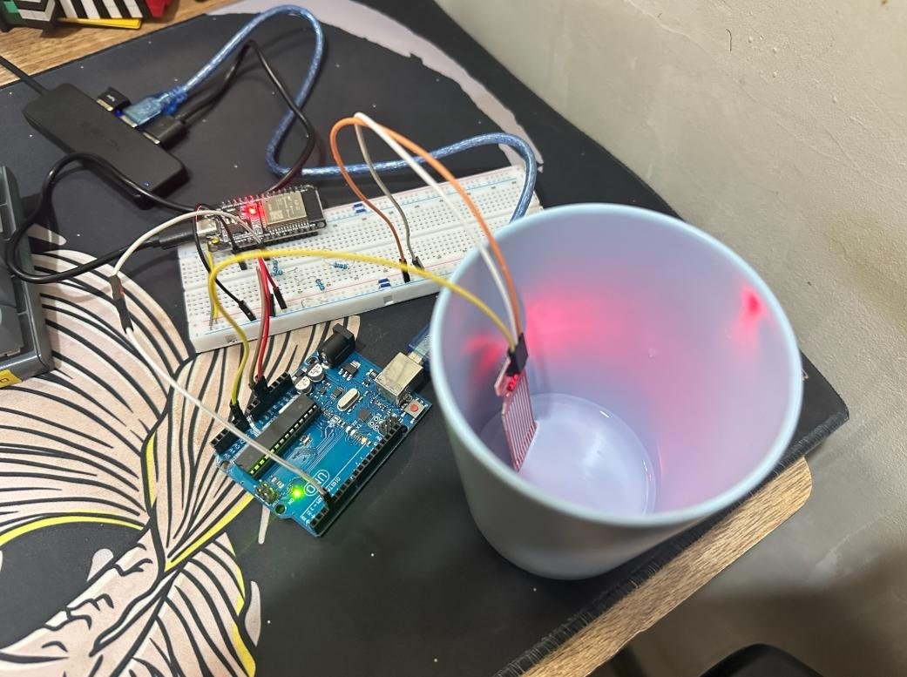

# Experiment 5: IoT based Water Monitoring System

**Course:** CPE162P – Embedded Systems with IoT

## Overview

A water monitoring system that reads an analog water sensor, converts the reading into a flow rate, and logs it to ThingSpeak. The Arduino Uno does the sensing and the conversion, and an ESP32 uploads the result over WiFi. The flow rate is the raw reading divided by 50.265, a calibration value I derived from the volume of the container.

## Hardware

**Arduino Uno**
- Water level sensor (A0)

**ESP32**
- WiFi link to ThingSpeak

## Libraries

- `SoftwareSerial.h` (Uno): serial link to the ESP32
- `WiFi.h` (ESP32): connects to the WiFi network
- `ThingSpeak.h` (ESP32): writes fields to the ThingSpeak channel

## How it works

- Every 15 s (a `millis()` timer) the Uno reads the sensor on A0 and prints a level estimate to the Serial Monitor, from "NO WATER" through 1/8, 1/4, 1/2 and 3/4 up to "WATER IS FULL".
- It computes `flowRate = waterLevel / 50.265` and sends it as one line over SoftwareSerial (Uno RX/TX = pins 2/3) to the ESP32's `Serial2` (RX/TX = GPIO 16/17) at 9600 baud.
- The ESP32 converts the line with `toFloat()` and uploads each value it receives (once every 15 s) to Field 1.

## Setup

The WiFi credentials and ThingSpeak write API key in `esp32/esp32.ino` were replaced with placeholders. Fill in `YOUR_WIFI_SSID`, `YOUR_WIFI_PASSWORD` and `YOUR_THINGSPEAK_WRITE_API_KEY`, and set `CHANNEL_ID` to your own ThingSpeak channel before uploading.

## Files

| File | Description |
|---|---|
| [`arduino/arduino.ino`](arduino/arduino.ino) | Arduino Uno sketch: water level reading, flow rate calculation, serial output |
| [`esp32/esp32.ino`](esp32/esp32.ino) | ESP32 sketch: receives the flow rate and uploads it to ThingSpeak |

## Demo

- [Raw video](https://youtu.be/wzE9UGozcF8)
