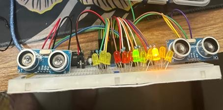

# Experiment 6: IoT based Building System

**Course:** CPE162P – Embedded Systems with IoT

## Overview

An occupancy system for a four-floor building model: it counts the people on each floor, turns on that floor's lights to match, and logs the counts to ThingSpeak. Instead of PIR sensors, I used two ultrasonic sensors, one to add an occupant and one to remove one, with the measured distance choosing the floor. The Arduino Uno handles the sensing and the 12 LEDs, and an ESP32 uploads the counts over WiFi.

## Hardware

**Arduino Uno**
- Ultrasonic sensor 1, adds occupants (trig A0, echo A1)
- Ultrasonic sensor 2, removes occupants (trig A2, echo A3)
- 12 LEDs, three per floor: floor 1 on pins 13–11, floor 2 on pins 10–8, floor 3 on pins 7–5, floor 4 on pins 4–2

**ESP32**
- WiFi link to ThingSpeak

## Libraries

- `NewPing.h` (Uno): reads distance from the ultrasonic sensors (50 cm max)
- `SoftwareSerial.h` (Uno): serial link to the ESP32
- `WiFi.h` (ESP32): connects to the WiFi network
- `ThingSpeak.h` (ESP32): writes fields to the ThingSpeak channel

## How it works

- Every 500 ms the Uno pings both sensors. A reading under 10 cm maps to floor 1, under 20 cm to floor 2, under 30 cm to floor 3 and under 40 cm to floor 4.
- Sensor 1 adds a person to that floor (up to 3) and sensor 2 removes one (down to 0). A sensor must read clear again before it counts another person, so an object held in front of it counts only once.
- Each floor lights one LED per occupant.
- After each reading the Uno sends `floor1,floor2,floor3,floor4,total` as one line over SoftwareSerial (Uno RX/TX = A4/A5, since pins 2–13 drive the LEDs) to the ESP32's `Serial2` (RX/TX = GPIO 16/17) at 9600 baud.
- The ESP32 splits the five values with `indexOf()` and `substring()` and uploads them at most once every 20 s: Fields 1–4 = occupants on floors 1–4, Field 5 = building total.

## Setup

The WiFi credentials and ThingSpeak write API key in `esp32/esp32.ino` were replaced with placeholders. Fill in `YOUR_WIFI_SSID`, `YOUR_WIFI_PASSWORD` and `YOUR_THINGSPEAK_WRITE_API_KEY`, and set `CHANNEL_ID` to your own ThingSpeak channel before uploading.

## Files

| File | Description |
|---|---|
| [`arduino/arduino.ino`](arduino/arduino.ino) | Arduino Uno sketch: occupant counting, floor lighting, serial output |
| [`esp32/esp32.ino`](esp32/esp32.ino) | ESP32 sketch: parses the floor counts and uploads them to ThingSpeak every 20 s |

## Demo

- [Raw video](https://youtu.be/41q3ZGlAnvU)
