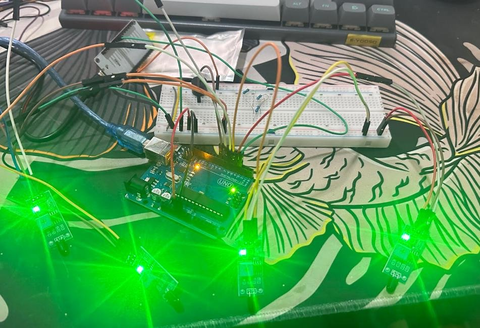

# Experiment 7: IoT based Fire Alarm System

**Course:** CPE162P – Embedded Systems with IoT

## Overview

A fire alarm for a four-story building model: one flame sensor per floor, a buzzer that sounds when any floor detects fire, and ThingSpeak logging that shows which floor is affected. The Arduino Uno reads the sensors and drives the buzzer, and an ESP32 uploads the states over WiFi. At first the system did the opposite of what I expected, because the flame sensors are active LOW (they output 0 when they see fire), so the code inverts each reading with `!digitalRead()`.

## Hardware

**Arduino Uno**
- 4 flame sensors, floors 1–4 (pins 4, 5, 6, 7)
- Buzzer (pin 8)

**ESP32**
- WiFi link to ThingSpeak

## Libraries

- `SoftwareSerial.h` (Uno): serial link to the ESP32
- `WiFi.h` (ESP32): connects to the WiFi network
- `ThingSpeak.h` (ESP32): writes fields to the ThingSpeak channel

## How it works

- The Uno continuously reads the four sensors, inverting each so 1 = fire. If any floor reports fire (`fire1 || fire2 || fire3 || fire4`), the buzzer turns on.
- Every 1 s (a `millis()` timer) it sends `fire1,fire2,fire3,fire4,buzzer` as one line over SoftwareSerial (Uno RX/TX = pins 2/3) to the ESP32's `Serial2` (RX/TX = GPIO 16/17) at 9600 baud.
- The ESP32 splits the five values with `indexOf()` and `substring()` and uploads them at most once every 20 s: Fields 1–4 = fire state of floors 1–4, Field 5 = buzzer state.

## Setup

The WiFi credentials and ThingSpeak write API key in `esp32/esp32.ino` were replaced with placeholders. Fill in `YOUR_WIFI_SSID`, `YOUR_WIFI_PASSWORD` and `YOUR_THINGSPEAK_WRITE_API_KEY`, and set `CHANNEL_ID` to your own ThingSpeak channel before uploading.

## Files

| File | Description |
|---|---|
| [`arduino/arduino.ino`](arduino/arduino.ino) | Arduino Uno sketch: flame sensing, buzzer control, serial output |
| [`esp32/esp32.ino`](esp32/esp32.ino) | ESP32 sketch: parses the floor states and uploads them to ThingSpeak every 20 s |

## Demo

- [Raw video](https://youtu.be/ZX1Xus6bVRQ)
