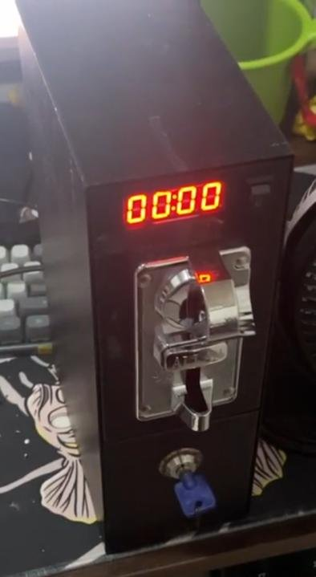

# Final Project: Arduino and ESP32 Based Pisonet

**Course:** CPE162P – Embedded Systems with IoT

## Overview

A smart controller for a Pisonet (a coin-operated PC): coins add time, and a relay powers the PC monitor only while time remains. Standard Pisonet timer boards only count coins and cut power, so this one also watches over the cabinet: a DHT11 sounds a buzzer if the inside goes above 37.0°C, and a photoresistor lights a warning LED if the dark cabinet is opened. An IR remote gives the operator an admin override to turn the monitor on without coins, and an ESP32 uploads the machine's status to ThingSpeak.

## Hardware

**Arduino Uno**
- Universal coin slot (pin 2, hardware interrupt)
- Relay switching the monitor's 220V AC power (A2, active LOW)
- DHT11 temperature and humidity sensor (pin 7)
- Photoresistor (LDR) tamper sensor (A0)
- Warning LED (pin 3)
- Buzzer (pin 4)
- IR receiver (pin 6) and IR remote
- TM1637 seven-segment display (CLK pin 9, DIO pin 8)

**ESP32**
- WiFi link to ThingSpeak

## Libraries

- `SoftwareSerial.h` (Uno): serial link to the ESP32
- `TM1637Display.h` (Uno): shows the remaining time
- `IRremote.hpp` (Uno): decodes the admin remote
- `DHT.h` (Uno): reads the DHT11
- `WiFi.h` (ESP32): connects to the WiFi network
- `ThingSpeak.h` (ESP32): writes fields and status to the ThingSpeak channel

## How it works

- Each coin pulse (falling edge on pin 2, 30 ms debounce) adds 300 s and ₱1; the coin slot sends one pulse per peso. The timer counts down once per second and the display shows MM:SS (HH:MM above one hour).
- The relay powers the monitor while time remains or the admin override is on (IR code `0xF30CFF00` toggles it). Every relay switch detaches the coin interrupt for 100 ms and clears its pending flag, so relay noise isn't counted as coins.
- The DHT11 is read every 2 s; above 37.0°C the buzzer beeps rapidly. It also gives a short beep every 10 s during the last minute. An LDR reading above 100 lights the tamper LED.
- Every second, and after each coin or override change, the Uno sends `seconds,pesos,monitor,box,temp,hum` as one line over SoftwareSerial (Uno RX/TX = A3/A4) to the ESP32's `Serial2` (RX/TX = GPIO 16/17) at 9600 baud.
- The ESP32 uploads the latest values every 16 s (ThingSpeak rejects updates faster than 15 s): Field 1 = remaining minutes, Field 2 = total pesos, Field 3 = monitor on/off, Field 4 = tamper status, Field 5 = temperature, Field 6 = humidity, plus `Time: HH:MM:SS` as the channel status. It reconnects to WiFi if the connection drops.

## Setup

The WiFi credentials and ThingSpeak write API key in `esp32/esp32.ino` were replaced with placeholders. Fill in `YOUR_WIFI_SSID`, `YOUR_WIFI_PASSWORD` and `YOUR_THINGSPEAK_WRITE_API_KEY`, and set `CHANNEL_ID` to your own ThingSpeak channel before uploading.

## Results

The coin slot counted pulses correctly in 16 of 16 trials with 1, 5 and 10 peso coins, and the relay switched the monitor correctly in 30 of 30 trials. The buzzer stayed off at 32.5°C and 35.0°C and sounded at 37.5°C and 40.2°C, and the LDR read under 10 with the cabinet closed versus about 250 in dim room light, well clear of the threshold of 100.

## Files

| File | Description |
|---|---|
| [`arduino/arduino.ino`](arduino/arduino.ino) | Arduino Uno sketch: coin timer, relay, sensors, display, IR override, serial output |
| [`esp32/esp32.ino`](esp32/esp32.ino) | ESP32 sketch: parses the status line and uploads it to ThingSpeak every 16 s |
