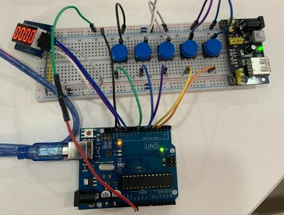

# Experiment 1: Real-time Scoreboard for a Basketball Game

**Course:** CPE161P – Real-time Embedded Systems

## Overview

A two-team basketball scoreboard on a single TM1637 4-digit display. Five push buttons add or subtract a point for Team A or Team B, or reset both scores, and each score is kept between 0 and 99. The tricky part was fitting two scores on one module: I multiply Team A's score by 100 and add Team B's, so Team A fills the first two digits and Team B the last two.

## Hardware

- Arduino Uno
- TM1637 4-digit seven-segment display (CLK 12, DIO 13)
- 5 push buttons (pins 4–8, `INPUT_PULLUP`, so no external resistors)

## Libraries

- `TM1637Display` – drives the 4-digit display

## How it works

- `loop()` reads the buttons (pressed = `LOW`): pins 8/7 add/subtract for Team A, pins 6/5 for Team B, pin 4 resets both.
- Scores are clamped to 0–99, combined as `teamA * 100 + teamB`, and shown with `display.showNumberDec(finalScore, true)` (leading zeros on).
- The loop repeats every 80 ms with `delay(TEST_DELAY)`; there's no edge detection, so holding a button keeps counting.

## Files

| File | Description |
|---|---|
| [`01-real-time-scoreboard-for-a-basketball-game.ino`](01-real-time-scoreboard-for-a-basketball-game.ino) | Arduino sketch |

## Demo

- [Raw video](https://youtu.be/kEKw4cJDvbs)
