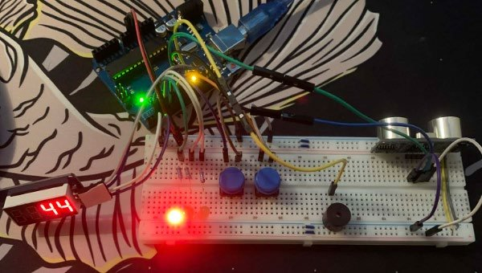

# Experiment 2: Real-time Traffic Light

**Course:** CPE161P – Real-time Embedded Systems

## Overview

A traffic light with red, yellow and green LEDs and a countdown on a TM1637 display. Red counts up to 60 seconds, then green counts down from 60 and hands over to yellow at 30 for the rest of the count. Two buttons act as manual overrides: one shortens red to 45 seconds if pressed early, the other adds 30 seconds to green. I also added violation detection: during red, an ultrasonic sensor watches the "stop line" and sounds a buzzer if something comes within 30 cm, like a car running the light.

## Hardware

- Arduino
- Red, yellow and green LEDs (pins 2, 3, 4)
- TM1637 4-digit seven-segment display (CLK 12, DIO 13)
- 2 push buttons (pins 6, 7)
- Ultrasonic sensor (trig 8, echo 9)
- Buzzer (pin 10)

## Libraries

- `TM1637Display` – shows the countdown

## How it works

- `trafficLight()` is a state machine on `state` (2 = red, 0 = green, 1 = yellow); each phase is a `while` loop that lights its LED, shows `timer` via `printTime()`, and steps the timer once per second.
- `changeTime()` handles the overrides: pin 6 during red sets `maxRed` to 45 if `timer < 30`; pin 7 during green adds 30 s (capped at 60).
- During red, `getDistance()` pulses the trigger and times the echo with `pulseIn()`; under 30 cm it calls `tone(BUZZER_PIN, 1000)`, otherwise `noTone()`.
- Each tick is a blocking `delay(1000)`, so the buttons and the sensor are only checked once per second.

## Files

| File | Description |
|---|---|
| [`02-real-time-traffic-light.ino`](02-real-time-traffic-light.ino) | Arduino sketch |

## Demo

- [Raw video](https://youtu.be/DPyWdaP4D2U)
