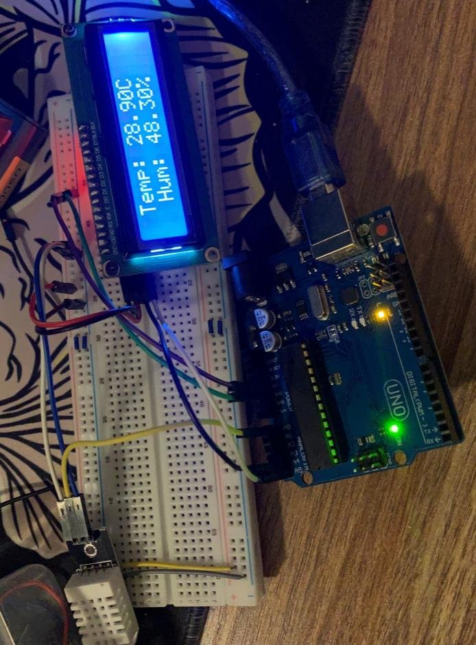

# Experiment 3: Weather Monitoring

**Course:** CPE161P – Real-time Embedded Systems

## Overview

A small weather station, like the digital thermometers we see in daily life. It reads temperature and humidity from a DHT22 sensor and shows them on a 16x2 LCD, refreshing about every 100 ms so changes appear right away. Unlike a simple thermistor, the DHT22 gives digital readings for both temperature and humidity.

## Hardware

- Arduino Uno
- DHT22 temperature and humidity sensor (pin A0)
- 16x2 LCD with I2C module (address `0x27`)

## Libraries

- `DHT22` – reads temperature and humidity from the sensor
- `LiquidCrystal_I2C` – drives the LCD over I2C

## How it works

- `loop()` calls `printDHT()`, which reads `getTemperature()` and `getHumidity()`, prints both to the serial monitor, and writes them to the LCD (°C on row 1, % on row 2).
- A `delay(100)` at the end of `printDHT()` sets the refresh rate to about every 100 ms.

## Files

| File | Description |
|---|---|
| [`03-weather-monitoring.ino`](03-weather-monitoring.ino) | Arduino sketch |

## Demo

- [Raw video](https://youtu.be/52fFbSKkTRU)
