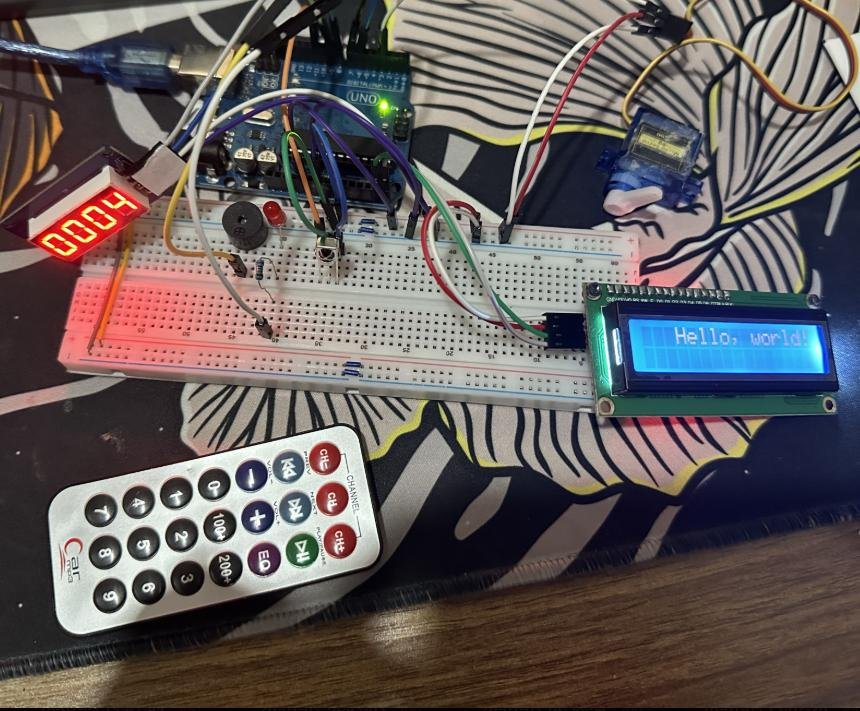

# Experiment 4: Appliance Controller

**Course:** CPE161P – Real-time Embedded Systems

## Overview

A simulated home automation system where an IR remote toggles five "appliances": a 16x2 LCD backlight, a buzzer, an LED, a servo motor and a TM1637 display. Two more remote buttons count a number up or down on the TM1637. I used an IR receiver and remote instead of a keypad to make the system truly wireless.

## Hardware

- Arduino Uno
- IR receiver (pin 11) and IR remote
- 16x2 LCD with I2C module (address `0x27`)
- Buzzer (pin 7)
- LED with resistor (pin 6)
- Servo motor (pin 3)
- TM1637 4-digit seven-segment display (CLK 9, DIO 8)

## Libraries

- `IRremote` – decodes the remote's IR codes
- `LiquidCrystal_I2C` – drives the LCD
- `Servo` – positions the servo motor
- `TM1637Display` – drives the 4-digit display

## How it works

- `loop()` checks `IrReceiver.decode()` and matches `decodedRawData` against the remote's hex codes: keys 1–5 flip the `LCD_ON`, `BUZZER_ON`, `LED_ON`, `MOTOR_ON` and `SSD_ON` flags; `IrReceiver.resume()` then waits for the next code.
- `+`/`-` change `num` only while `SSD_ON` is true, like a device you can't adjust while it's off.
- Every pass applies the flags: LCD backlight on/off (it shows "Hello, world!"), LED and buzzer `HIGH`/`LOW`, servo at 120° or 0°, and the TM1637 shows `num` or clears.
- There's no `delay()` in the loop, so each key press takes effect immediately.

## Files

| File | Description |
|---|---|
| [`04-appliance-controller.ino`](04-appliance-controller.ino) | Arduino sketch |

## Demo

- [Raw video](https://youtu.be/RIE0ijPiGd8)
