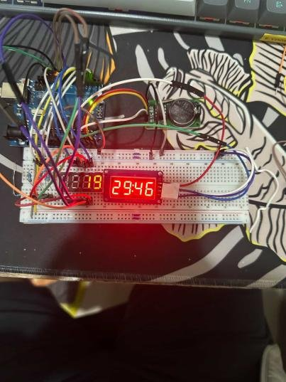

# Experiment 5: Real-time Clock

**Course:** CPE161P – Real-time Embedded Systems

## Overview

A digital clock that shows hours, minutes and seconds from a DS1302 real-time clock module across two displays: the hour on a raw 4-digit seven-segment display (3461-1 AS) and minutes:seconds on a TM1637 module. Unlike earlier experiments that timed things with `delay()`, which blocks the processor and drifts, the RTC keeps time on its own, so the clock stayed correct even when the Arduino was reset.

## Hardware

- Arduino Uno
- DS1302 RTC module (RST 17/A3, DAT 18/A4, CLK 19/A5)
- TM1637 4-digit seven-segment display (CLK 14/A0, DIO 15/A1)
- 3461-1 AS 4-digit common-cathode seven-segment display (digits on pins 2–5, segments A–G and DP on pins 6–13)
- Resistors

## Libraries

- `Ds1302` – reads the time from the RTC module
- `TM1637Display` – shows minutes and seconds
- `SevSeg` – multiplexes the raw 4-digit display (12 pins: 4 digits + 8 segments)

## How it works

- `loop()` reads the RTC with `rtc.getDateTime(&now)` on every pass, but only updates the displays when `now.second` differs from `last_second`, which avoids constant redraws and flicker.
- The hour goes to the raw display with `sevseg.setNumber(now.hour)`; minutes and seconds go to the TM1637 with `showNumberDecEx(..., 0b01000000, true, 2, pos)` (colon on, leading zeros).
- `sevseg.refreshDisplay()` runs on every pass because the raw display is multiplexed in software, so the loop has no `delay()`. All timing comes from the RTC chip.
- The sketch only reads the time; it doesn't set the RTC.

## Files

| File | Description |
|---|---|
| [`05-real-time-clock.ino`](05-real-time-clock.ino) | Arduino sketch |

## Demo

- [Raw video](https://youtu.be/_tqmYx3zzr0)
