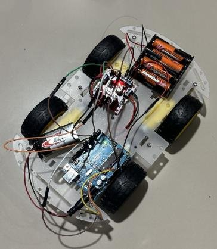

# Experiment 6: Self Driving Car

**Course:** CPE161P – Real-time Embedded Systems

## Overview

Despite the title, this car is driven with an IR remote. The Arduino decodes the hex code of each remote button and sets the motor driver's IN1–IN4 pins to move forward, backward, left or right. There's no stop button: the car stops on its own when the remote signal stops coming in.

## Hardware

- Arduino
- IR receiver (pin 8) and IR remote
- H-bridge motor driver and motors (IN1–IN4 on pins 3, 5, 6, 9)

## Libraries

- `IRremote` – decodes the remote's IR codes

## How it works

- `loop()` reads `IrReceiver.decodedIRData.decodedRawData` and calls `Forward()`, `Backward()`, `Left()` or `Right()` for the matching button.
- Each movement function writes a HIGH/LOW pattern to IN1–IN4: `Forward()` and `Backward()` drive both motor channels with opposite polarity, while `Left()` and `Right()` drive only one channel.
- Every valid code stores `millis()` in `lastSignalTime`; if 700 ms (`timeoutDelay`) pass with no signal, `Stop()` sets all four pins LOW. This uses `millis()` instead of `delay()`, so the receiver is never blocked.

## Files

| File | Description |
|---|---|
| [`06-self-driving-car.ino`](06-self-driving-car.ino) | Arduino sketch |

## Demo

- [Raw video](https://youtu.be/UNCJmaivQOk)
