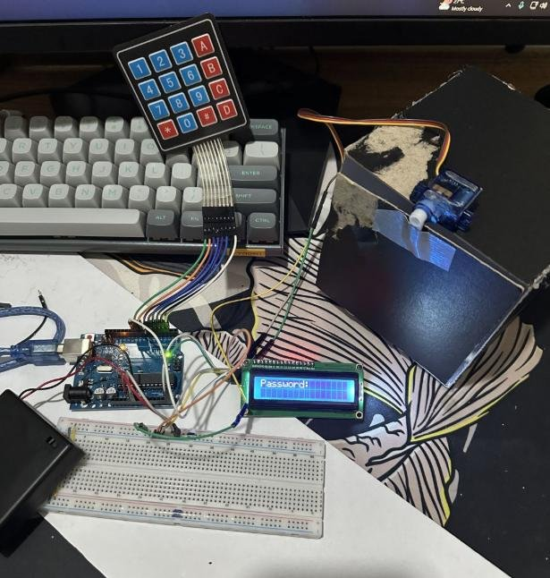

# Experiment 7: Real-time Vault System

**Course:** CPE161P – Real-time Embedded Systems

## Overview

A keypad-controlled vault. Entering the correct 6-key passcode and pressing `D` turns a servo to 90° to unlock, shows "Opened!" on the LCD, and starts a 10-second countdown before the vault locks itself again. Pressing `B` while it's open adds 5 seconds. I timed the open period with `millis()` instead of `delay()` so the keypad stays responsive while the vault is open.

## Hardware

- Arduino Uno
- 4x4 matrix keypad (rows on pins 9, 8, 7, 6; columns on pins 5, 4, 3, 2)
- 16x2 LCD with I2C module (address `0x27`)
- Servo motor (pin 10)
- External power supply

## Libraries

- `Keypad` (`Keypad.h`, `Key.h`) – reads the 4x4 keypad
- `Servo` – drives the locking servo
- `LiquidCrystal_I2C` – drives the LCD

## How it works

- `loop()` calls `locker()`, which reads a key with `customKeypad.getKey()`: `D` submits to `checkPass()`, and other keys go to `typeKey()`, which stores up to 6 of them (ignoring `A`–`D`) in `data` and echoes them on the LCD.
- `checkPass()` compares `data` with the hard-coded master code using `strcmp()`; on a match it turns the servo to 90° and calls `timer(open_duration)`, otherwise it shows "Wrong password!" for 3 s.
- `timer()` counts down 10 s by checking `millis()` and keeps polling the keypad so `B` can add 5 s; at zero, `lockDoor()` returns the servo to 0° and shows "Locked!".
- The countdown runs in its own `while` loop, and the "Wrong password!" and "Locked!" messages use blocking `delay()`.

## Files

| File | Description |
|---|---|
| [`07-real-time-vault-system.ino`](07-real-time-vault-system.ino) | Arduino sketch |

## Demo

- [Raw video](https://youtu.be/RMxyA5i632A)
