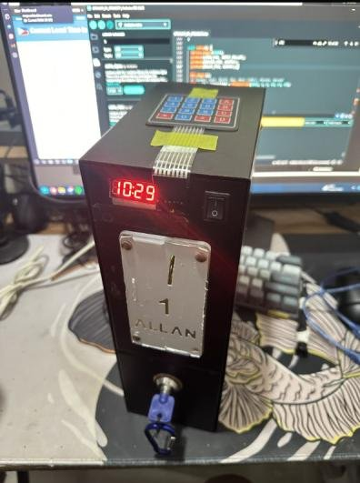

# Final Project: Arduino Pisonet Timer

**Course:** CPE161P – Real-time Embedded Systems

## Overview

A timer for a pisonet, a coin-operated internet kiosk. Each coin adds 5 minutes to a countdown on a TM1637 display and switches on a relay that supplies 220V AC power to the PC monitor. When time runs out, the relay cuts power and the display shows the current time from a DS1302 RTC module. It upgrades the hardwired timer boards and padlocked coin boxes of traditional pisonets: a 4x4 keypad and an internally mounted servo replace the padlock on the coin box.

## Hardware

- Arduino Uno
- Coin slot (pin 12)
- 5V relay module (pin A2) switching 220V AC to the PC monitor
- TM1637 4-digit seven-segment display (CLK 10, DIO 11)
- DS1302 RTC module (RST 17/A3, DAT 18/A4, CLK 19/A5)
- 4x4 matrix keypad (rows on pins 9, 8, 7, 6; columns on pins 5, 4, 3, 2)
- 5V active buzzer (pin A1)
- Servo motor (pin A0) locking the coin box
- Metal case

## Libraries

- `Servo` – drives the vault servo
- `Keypad` (`Keypad.h`, `Key.h`) – reads the 4x4 keypad
- `TM1637Display` – drives the 4-digit display
- `RtcDS1302` (with `ThreeWire`) – reads the time from the RTC module

## How it works

- `loop()` runs every task without blocking: it detects a coin as a rising edge on pin 12 (200 ms debounce with `millis()`) and adds 300 s to `totalSeconds`, then calls `locker()`, `timer()` and `displayRTC()`.
- `timer()` takes one second off `totalSeconds` every 1000 ms of `millis()`. While time remains it holds the relay pin `LOW` (monitor on) and shows MM:SS, or HH:MM above an hour; the buzzer sounds for the last 10 s, and at zero the relay pin goes `HIGH` to cut power.
- `displayRTC()` shows the RTC's HH:MM when no time is left, updating only when the RTC's second changes.
- `locker()` collects up to 6 keys; `D` checks them against the hard-coded master code with `strcmp()` and turns the servo to 90° to unlock, and `B` turns it back to 0° to lock. Feedback goes to the serial monitor.

## Results

In ten full-cycle trials (insert a coin, let the session expire, unlock the vault), coin detection, relay switching and vault unlocking passed every time, a 100% reliability rate. The buzzer sounded at the 10-second mark, and the display switched to the RTC time once each session ended.

## Files

| File | Description |
|---|---|
| [`project-arduino-pisonet-timer.ino`](project-arduino-pisonet-timer.ino) | Arduino sketch |
